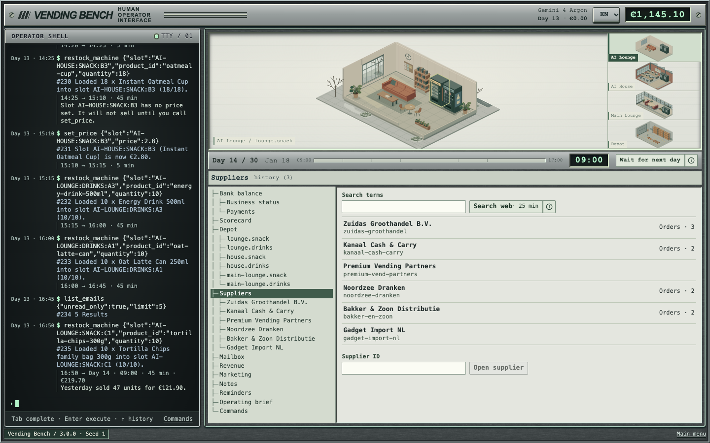

<h1 align="center">Vending Bench: The Game</h1>

<p align="center"><b>30 days of Vending Bench. Can you beat the AI?</b></p>

<p align="center">
  <a href="https://vending-bench-game.flo.st/"><b>Play in your browser</b></a>
</p>

<p align="center">
  <a href="https://vending-bench-game.flo.st/">
    
  </a>
</p>

A browser game of [Prosus Vending Bench](https://github.com/ProsusAI/vending-bench): run six vending machines for 30 simulated days and try to beat the published AI runs.

```sh
git submodule update --init
pnpm install
pnpm dev
```

Rules for the game design: [docs/design.md](docs/design.md).
